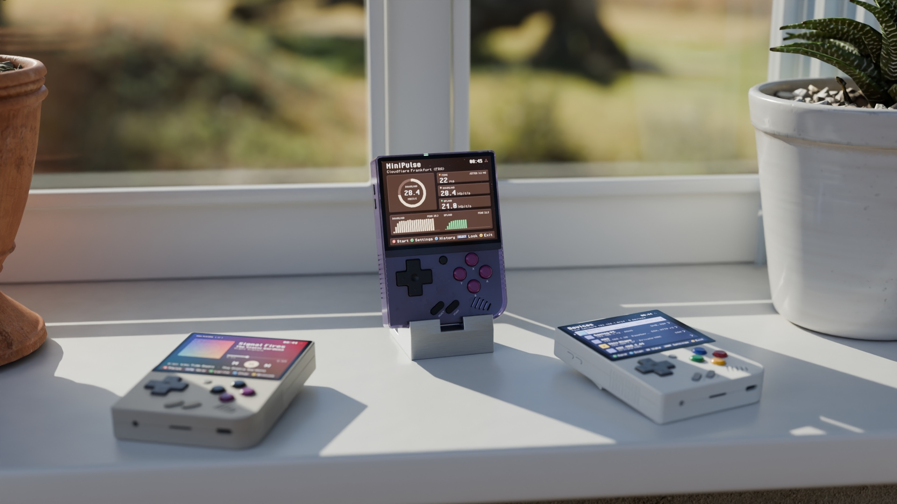
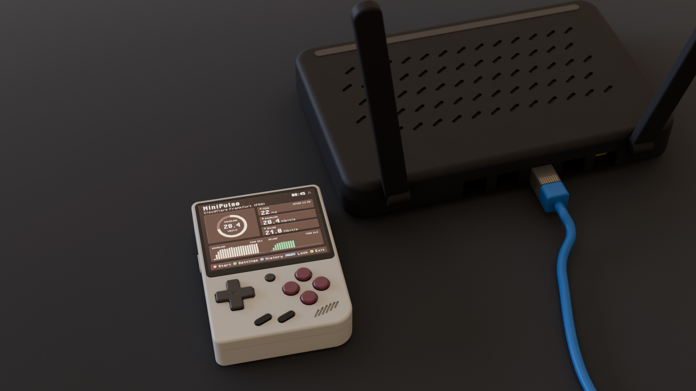

<p align="center"></p>

[](https://github.com/zakijss/MiniPulse/actions/workflows/ci.yml)
[](https://github.com/zakijss/MiniPulse/releases)
[](LICENSE)

# MiniPulse

Latency, jitter, download and upload speed over the Miyoo Mini Plus's Wi-Fi. Part of [MiniDeck](https://github.com/zakijss/MiniDeck).

- Against Cloudflare's nearest data centre (no account), or your own [LibreSpeed](https://github.com/librespeed/speedtest) or [OpenSpeedTest](https://openspeedtest.com) server, at home or on your tailnet.
- Three connections for ten seconds each way, as browser speed tests do, with the Wi-Fi signal beside each result.
- The last 50 results.


<p align="center"></p>

## Using it

**A** starts and stops a test and **X** opens the history. **Y** opens the settings: the server, the test length (5, 10 or 20 seconds each way), the connections (1, 3 or 6) and Mbit/s or MB/s.

A finished test says how its download compares with your usual (the median of your earlier tests). After an error, **A** tries again.

In the history, **A** shows a result on the main screen with its graphs, **START** runs a new test, **Y** deletes a result, **X** clears them all, and **L2** and **R2** jump to the newest and oldest.

## Install

- **MiniMart:** open [MiniMart](https://github.com/zakijss/MiniMart), then **Apps > MiniPulse**. It checks the download and keeps your settings on updates.
- **Zip:** download `minipulse-VERSION.zip` from [Releases](https://github.com/zakijss/MiniPulse/releases/latest), unzip it onto the root of the SD card, and restart.
- **Every MiniDeck app at once:** [minideck-all.zip](https://github.com/zakijss/MiniDeck/releases/latest/download/minideck-all.zip).

## Requirements

A Miyoo Mini Plus on Onion OS 4.4, with Wi-Fi. Other devices and firmwares aren't supported.

## Building

```sh
make check                     # vet, tests, scripts
make package VERSION=1.0.0     # dist/: the release zip, app.json, SHA256SUMS
make deploy HOST=root@miyoo    # build and copy to a device over SSH
```

Go runs in Docker unless you pass `GO=go` (Go 1.27). The interface, themes and networking come from the [MiniDeck library](https://github.com/zakijss/MiniDeck); see its [development notes](https://github.com/zakijss/MiniDeck/blob/main/docs/DEVELOPMENT.md) and [contributing guide](https://github.com/zakijss/MiniDeck/blob/main/CONTRIBUTING.md).

## License

[MIT](LICENSE). Third-party components are listed in [NOTICE](NOTICE). Not made by or affiliated with Miyoo.
