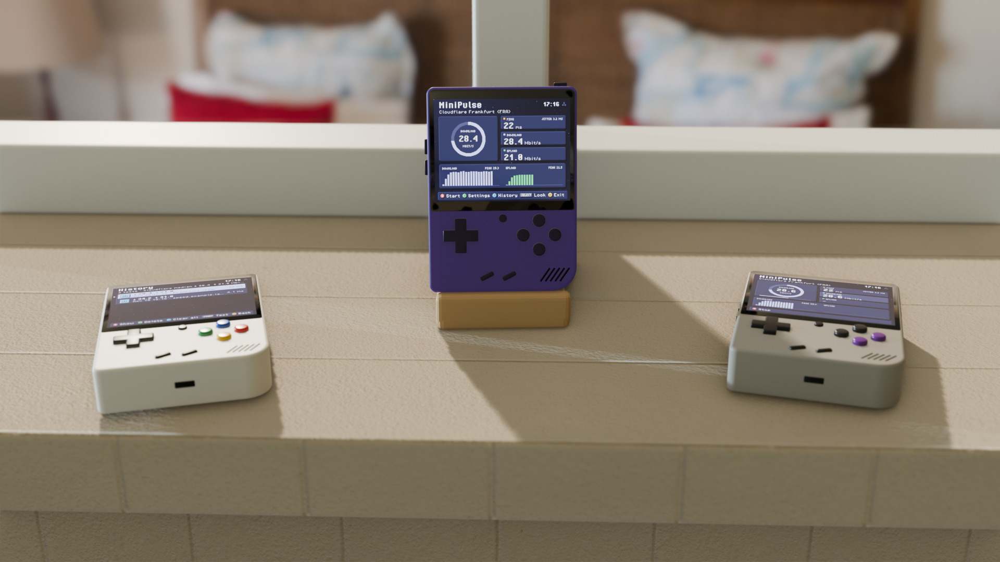
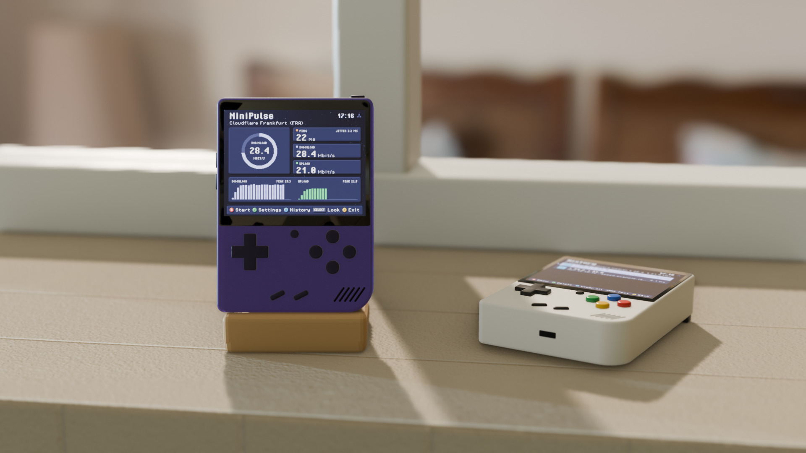

<p align="center"></p>

[](https://github.com/zakijss/MiniPulse/actions/workflows/ci.yml)
[](https://github.com/zakijss/MiniPulse/releases)
[](LICENSE)

# MiniPulse

Latency, jitter, download and upload speed over the Miyoo Mini Plus's Wi-Fi. Part of [MiniDeck](https://github.com/zakijss/MiniDeck).

- Tests against Cloudflare's nearest data centre (no account), or your own [LibreSpeed](https://github.com/librespeed/speedtest) or [OpenSpeedTest](https://openspeedtest.com) server, at home or on your tailnet.
- Three connections for ten seconds each way, as browser speed tests do, with the Wi-Fi signal beside each result.
- Says how a download compares with your usual: the median of your earlier tests against the same server.
- Keeps the last 50 results.

<p align="center"></p>

## Install

Open [MiniMart](https://github.com/zakijss/MiniMart) and pick **Apps > MiniPulse**: it checks the download and keeps your settings on updates. Or unzip `minipulse-VERSION.zip` from [Releases](https://github.com/zakijss/MiniPulse/releases/latest) onto the root of the SD card and restart. Every MiniDeck app comes in one zip too: [minideck-all.zip](https://github.com/zakijss/MiniDeck/releases/latest/download/minideck-all.zip).

Needs a Miyoo Mini Plus on Onion OS 4.4, with Wi-Fi. Other devices and firmwares aren't supported.

## Using it

**A** starts and stops a test (and tries again after an error), **X** opens the history and **Y** the settings: the server, the test length (5, 10 or 20 seconds each way), the connections (1, 3 or 6) and Mbit/s or MB/s. The Wi-Fi signal on the main screen updates every two seconds, so you can walk around to find a better spot before testing.

In the history, **A** shows a result with its graphs, **START** runs a new test, **Y** deletes a result, **X** clears them all, and **L2**/**R2** jump to the newest and oldest. The medians shown are those of the selected result's server.

## Building

```sh
make check                     # vet, tests, scripts
make package VERSION=1.0.0     # dist/: the release zip, app.json, SHA256SUMS
make deploy HOST=root@miyoo    # build and copy to a device over SSH
```

Go runs in Docker unless you pass `GO=go` (Go 1.27). The interface, themes and networking come from the [MiniDeck library](https://github.com/zakijss/MiniDeck); see its [development notes](https://github.com/zakijss/MiniDeck/blob/main/docs/DEVELOPMENT.md) and [contributing guide](https://github.com/zakijss/MiniDeck/blob/main/CONTRIBUTING.md).

## License

[MIT](LICENSE). Third-party components are listed in [NOTICE](NOTICE). Not made by or affiliated with Miyoo.
